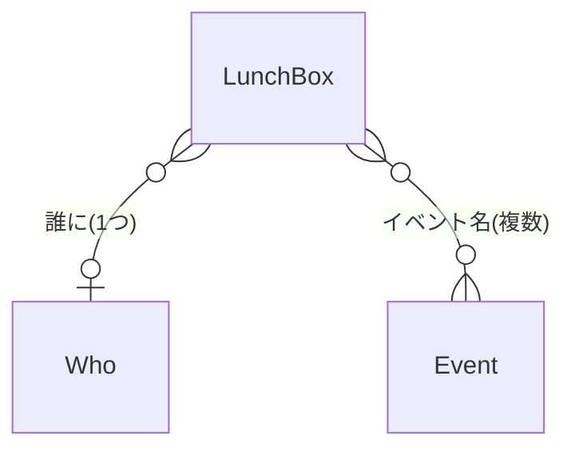

# お弁当日記 設計書

最終更新: 2026-11-11

何を作るかは `spec.md`、決まっていないことは `open-issues.md` に書く。この設計書には、決まった作り方だけを書く。

状態: 試作で確かめた部分を中心にまとめている。機能ごとの状態(検証済み・試作・未着手)は、10章にまとめた。

## 1. 技術構成

| 項目 | 内容 |
|---|---|
| 言語 | Swift |
| UI | SwiftUI |
| 保存 | SwiftData |
| 対象 OS | iOS 17 以上 |

**SwiftData を選んだ理由**
- 永続化が標準で用意されている
- `@Model` により変更が追跡され、SQL を書かなくてよい
- 注意点: `@Model` は class なので、参照が意図せず共有されることがある

## 2. データモデル

フレームは、別テーブルにせず、`LunchBox` の中に持つ(`Frame`)。

**LunchBox(1件の記録)**

| 項目 | 型 | 内容 |
|---|---|---|
| id | UUID | `@Attribute(.unique)` |
| title | String | 料理名 |
| image | Data | 拡大表示用のメイン画像。`@Attribute(.externalStorage)` で外部ストレージに保存する |
| thumbnail | Data | カレンダーのマスやリスト用の小さい画像。小さいので、そのまま持つ |
| date | Date | 選んだ日付を、そのまま保存する。同じ日かどうかは、読むときに `startOfDay` で判定する(4章) |
| memo | String? | 任意 |
| events | [Event] | 複数(決定、2026-11-11)。任意(空でもよい)。多対多の書き方は、試作で確認する(試作のコードは、まだ `Event?` の1つ) |
| who | Who? | 1つだけ。任意 |
| frame | Frame | テーマと色。必須 |

**Event / Who(名前だけを持つ)**

| 項目 | 型 | 内容 |
|---|---|---|
| id | UUID | `@Attribute(.unique)` |
| name | String | |

- 「誰に」とイベント名は、色を持たない(色を持つのはフレームだけ)
- 登録した名前から選ぶ。表記ゆれを防ぐ
- 関連の消し方(記録や、名前を削除したとき)は、まだ決めていない(`open-issues.md`)
- 「誰に」は1つ、イベント名は複数

**Frame(`struct`、`Codable`)**

| 項目 | 型 | 内容 |
|---|---|---|
| theme | FrameTheme | `enum`。`String` の raw 値で保存される |
| color | String | `#RRGGBB`(16進数の文字列) |

**FrameTheme(`enum`)**
- いまの `case`: `def`(ほしの枠)、`stripe`、`autumn`、`polaroid`、`cloud`、`note`、`star`、`mascot`
- 保存されるのは、名前(raw 値)。後から `case` を消したり、名前を変えたりすると、保存済みのデータが読めなくなる
- フレームを別テーブルにしない理由: 記録が覚えるのは、テーマと色だけで足りる。ユーザーがフレームを追加する機能はない。テーブルにすると、規模が増える

## 3. 画面と部品

| 部品 | 役割 |
|---|---|
| ホーム | カレンダーとリストを切り替える |
| 詳細 | シート。複数件のときは横にスワイプして切り替える |
| 作成・編集 | 画面。1つで兼用する |
| `FrameView`(大) | フレーム付きの完成カード(横長)。詳細と、作成・編集のプレビューで共有する共通部品。写真は、窓に合わせて `scaledToFill` で表示する(端が切れる) |
| 写真の全体表示 | カードの写真を `Button` で囲み、押すと写真の全体を見せる(`scaledToFit`)。メイン画像を使う。全画面(`fullScreenCover`)で見せる(決定、2026-11-11)。拡大(ピンチ)できるか、閉じ方は未決 |
| フレーム(小) | カレンダーのマス用の、縦長の小さいカード。`FrameView`(大)とは、別の View として作る(写真の窓の比率が違い、縮小では作れないため) |

**作成・編集の入力途中の扱い**
- `@Model` は class のため、入力欄を記録に直接つなぐと、キャンセルしても元のデータが書き換わる
- そのため、入力途中の内容は一時的な変数(`@State`)に持つ
- 保存ボタンを押したときに、記録へ書き込む
- 親から受け取るだけの値(例: `screenWidth`、`DayView` の `day`)は、`let` で受け取る。`@State` にすると、親が値を変えても、子は最初の値のまま残るため

## 4. カレンダー

**作り方**
- `UICalendarView` は、マス全体の見た目を変えられないため、採用しない
- 月ごとの表示は、`TabView`(`.page`)で切り替える
- 1か月は、日付を7個ずつに分けて(`chunked(into: 7)`)、`VStack`(週)と `HStack`(日)で並べる
- 1か月は、6行(42マス)に固定する。5行で終わる月は、6行目を空きマスで埋める
  - 確認が必要: 日曜始まりで28日の月(2026年2月)は、4行になり、35マスのままではないか(`open-issues.md`)

**月の持ち方(プロトタイプで検証済み。`verification.md` の2)**
- 前月・今月・来月の3か月分だけを持つ(`[MonthGroup]`)。月を移動するときは、片側に1か月足して反対側を捨てる。今見ている月が、常に真ん中
- 日付は、日本時間の0時ちょうど(`startOfDay`)にそろえる。同じ日かどうかを `==` で比べられる
- 月初の空きマスは、`date` が `nil` の `DateItem` で表す。数は、月初の曜日から決める

**マスの表示**
- 記録がある日: 先頭1件の写真を、フレーム付きの小さいカードで表示する。2件以上は件数のバッジを付ける(バッジは未実装)
- マスに、タイトルは出さない(狭くて崩れたため。`spec.md` 3章)
- 記録がない日: 日付のみ

**カレンダーと記録の連携(検証済み。`verification.md` の6)**
- `@Query` で、記録を全件、日付順に取る
- `Dictionary(grouping:by:)` で、`startOfDay` を鍵にして、日ごとにまとめる(`[Date: [LunchBox]]`)
- `DayView` は、自分の日付で引いて、あれば先頭1件を出す
- 先頭1件は、タイトル順の先頭にする(仕様)。試作は `lunches.first`(日付順の先頭)のまま。`sorted` で直す予定

**日付を押したときの分岐**
- 件数が0: 何もしない
- 件数が1以上: 詳細シートを開く(複数件なら横にスワイプして切り替える)(未実装)

## 5. 写真の保存

- 保存する写真は2種類。どちらも `Data` 型で持つ
  - メイン(拡大表示用): 画面の幅(pt)× 画面のスケールに収まる大きさ。`@Attribute(.externalStorage)` で外部ストレージに保存する
  - サムネイル(マスやリスト用): 200px に収まる大きさ
- どちらも JPEG 品質 0.5 で保存する
- 元画像は保存しない
- `Data` で持つ理由: SwiftData に保存できるのは `Data` で、`UIImage` はそのままでは保存できないため。表示するときに、`UIImage(data:)` で変換する

**保存の流れ**
1. `PhotosPicker` で選んだ写真を `Data` で読む
2. メイン用とサムネイル用の2つを、`shrinkAndComp` で作る(縮小 → JPEG 圧縮 → `Data`)
3. 2つを、記録に入れて保存する(元画像は捨てる)
- 記録を削除したときの写真ファイルの扱いは、SwiftData に任せる
- 容量の目安: 1日1件で、1年あたり約83.5MB(実測。`verification.md` の1-2)。元画像を残した場合は約1.2GB/年
- 縦向き写真の向きの確認は、まだ済んでいない

## 6. 検証の記録

試したこと、結果、そこから決めたことは `verification.md` に書く。この設計書には、決まった作り方だけを書く。

## 7. 主な関数

関数の中身(コード)は書かない。名前、受け取るもの、返すもの、役割、流れ、失敗したときの扱いを書く。コード側には、役割を `///` で1行書いておく。

**MonthGroup / DateItem**

| 型 | 項目 | 内容 |
|---|---|---|
| MonthGroup | id: Date | 月初の0時 |
| MonthGroup | dates: [DateItem] | その月のマス。空きマスを含む |
| DateItem | id: UUID | |
| DateItem | date: Date? | 空きマスは `nil` |

**firstDate**

`firstDate(_ date: Date) -> Date`

- 役割: 受け取った日付の、月初の0時を返す
- 失敗したとき: 受け取った日付を、そのまま返す

**getLastDate**

`getLastDate(_ date: Date) -> Date`

- 役割: 受け取った日付と同じ月の、最終日を返す
- 流れ
  1. 翌月の日付を作る
  2. 翌月の「0日」の日付を作る(0日は、前の月の最終日になる)
- 失敗したとき(仮。決め直す): 受け取った日付を、そのまま返す
- 補足: 日付を `print` すると UTC で表示される。日にちは `calendar.component` で取り出す

**daysInMonth**

`daysInMonth(_ date: Date) -> MonthGroup`

- 役割: その月の1日〜最終日と、前後の空きマス(`date` が `nil`)を入れた `MonthGroup` を返す
- 流れ
  1. 月初と最終日を求める
  2. 1日〜最終日の日付を作る
  3. 月初の曜日を調べ、(曜日の番号 − 1)個の空きマスを、先頭に入れる(日曜始まり)
  4. 最終日の曜日から、後ろの空きマスを入れて、週の区切りに合わせる
  5. 35個以下なら、7個足す(6行にするため)
- 失敗したとき(仮。決め直す): 日付が作れない日は、`date` が `nil` になる

**getMonthGroups**

`getMonthGroups(_ date: Date, _ group: [MonthGroup]?) -> [MonthGroup]`

- 役割: 前月・今月・来月の3つの `MonthGroup` を返す。今見ている月が、真ん中になる
- 流れ
  - `group` が `nil`(最初): `date` の前月・今月・来月を作って返す
  - `group` がある: `date` の月が、3つのうち何番目かを調べる
    - 先頭: 先頭に前月を足し、末尾を捨てる
    - 末尾: 末尾に来月を足し、先頭を捨てる
    - 真ん中、またはどれでもない: 何もしない
- 失敗したとき(仮。決め直す): 月が作れなければ、そのまま返す

**getDestMonth**

`getDestMonth(_ date: Date, _ offset: Int) -> Date`

- 役割: 月初に直したうえで、`offset` か月ずらした月初を返す(矢印ボタンの移動先)
- 失敗したとき: 月初を返す(動かない)

**shrinkAndComp**

`shrinkAndComp(_ data: Data, detailPx: CGFloat = 200) -> Data?`

- 役割: 写真を縮小し、JPEG(品質 0.5)に圧縮して、`Data` で返す
- 流れ
  1. `Data` から `UIImage` を作る(作れなければ `nil`)
  2. `preparingThumbnail(of:)` で、`detailPx` 四方に収まる大きさに縮小する
  3. `jpegData(compressionQuality: 0.5)` で `Data` にして返す
- 返す型を `Data` にした理由: 保存できるのが `Data` だけだから。表示のときに `UIImage` に直す
- 失敗したとき(仮。決め直す): 縮小に失敗すると、元の大きさの画像を、圧縮して返す(「元画像は保存しない」と食い違う。`open-issues.md`)

**detailPx**

`detailPx() -> CGFloat`

- 役割: メイン画像の大きさ(px)を返す。画面の幅(pt)× 画面の倍率
- 設計の変更(2026-11-10): `UIScreen.main` をやめた(非推奨のため)。画面の幅は、一番上の親の View で `.onGeometryChange` を使って取り、`@State var screenWidth` に入れて、`AdditionView` へ引数で渡す
- 倍率は、`@Environment(\.displayScale)` から取る(2026-11-11 に置き換え済み)
- 流れ: `displayScale × screenWidth`(たとえば 3 × 393 = 1179)
- global な変数には持たない(どこからでも書き換えられる。複数のウィンドウがあると、値が1つに決まらない)
- 動作確認: iOS 17 を対象にして、エラーなしで動いた(確認)
- 未決: 親の View の幅が、0 のときの扱い(最初のレイアウトの前)

**Color(hex:)**

`Color.init?(hex: String)`

- 役割: `#RRGGBB` の文字列から、`Color` を作る
- 流れ: 1. `#` を取り除く 2. 16進数として `Int` にする 3. 赤・緑・青を、ビット演算で取り出し、255 で割る 4. `Color(red:green:blue:)` を作る
- 失敗したとき: 16進数として読めなければ `nil`。呼ぶ側で、`?? .gray` などの代わりの色にする(`FrameView` は `.gray`)
- 未決: 6桁以外の入力(例: `#fff`)の扱い

**colorToStr**

`colorToStr(_ color: Color) -> String`

- 役割: `Color` を `#RRGGBB` の文字列にする(`ColorPicker` の結果を、保存できる形にする)
- 流れ
  1. `color.resolve(in:)` で、赤・緑・青の値を取り出す(iOS 17 以上の API。Xcode で確認)
  2. 0〜255 の整数に、四捨五入で直す
  3. `String(format: "%02X", ...)` で、2桁の16進数にして並べる(桁そろえ)
- 保存の流れ: `ColorPicker` → `Color` → `colorToStr` → `String` で保存。表示は、`Color(hex:)` で戻す

**textColor**

`textColor(_ bg: String) -> Color`

- 役割: 背景色(16進数)の上に置く、文字の色を返す
- 流れ: 1. 赤・緑・青を取り出す 2. 相対輝度を計算する(ガンマ補正し、0.2126・0.7152・0.0722 の重みで足す) 3. 0.35 より大きければ `#3A2E2E`、以下なら `#FFFFFF`
- 失敗したとき: 色が読めなければ、黒
- 補足: 0.35 は、モックを見て決めた値。実機で見て、調整してよい

## 8. フレーム(試作の範囲: 「ほしの枠」の大きいカード)

- テーマごとに、別の View として作る。ユーザーが選べるのは、テーマと色だけ
- 大きさは、全テーマで同じ(大: 326×244、小: 52×68)。写真の窓も同じ(大: 240×144、小: 40×42)

**`FrameView`(大)の作り**

- 入力: 色(16進数の文字列)
- 重ねる順番(下から): 角丸の背景(色は `Color(hex:)`、失敗したら `.gray`)→ 星 → 写真の窓 → 文字
- 背景: 角の丸み 24
- 写真の窓: 240×144、角の丸み 14、上から 16、左右は中央(左から 43)
- 星: `StarPosition`(左、上、大きさ)の配列を `ForEach` で並べる。白。`star.fill`。9個。位置はモックの値
- 文字: 左から 43、上から 170。日付 12pt(不透明度 0.9)、タイトル 19pt、2行の間は 3。色は `textColor`。フォントは「ヒラギノ丸ゴ ProN W4」(指定名は、実機での確認がまだ)
- 未決・直す予定
  - `StarPosition` の `id` が、作るたびに変わる(`UUID()`)。座標が同じなら、同じ `id` になる形にする
  - 星の座標の置き場所(`FrameTheme` の側にする方針)
  - 小さいカードの作り(別の View。星は3つ)

## 9. テスト

- 方針: 関数を作るたびに、「どんな入力に、何が返るべきか」を考える
- 対象にしやすいのは、入力と出力が決まる関数(`Color(hex:)`、`colorToStr`、`textColor`、`getLastDate`、`getMonthGroups` など)
- 考えておく入力の例
  - `Color(hex:)`: `#FFFFFF`、`FFFFFF`(`#` なし)、`#fff`(桁が足りない)、文字が混ざった文字列
  - `colorToStr`: 黒、白、桁が1つ足りない色(赤 10、緑 161、青 15 → `#0AA10F`)。元に戻る(往復)
  - `getLastDate`: 2026年2月(28日)、うるう年の2月、31日の月
- まだ、テストコードは書いていない

## 10. 機能ごとの状態

この設計書は、試作で確かめた部分から書いている。まだ設計していない機能は、事実のとおり「未着手」と書く。

| 機能 | 状態 | 設計書の場所 |
|---|---|---|
| 月のカレンダー(月の切り替え、マスの表示) | 試作で検証済み。件数のバッジ、先頭1件のタイトル順は未 | 4章 |
| 写真の縮小・圧縮・保存 | 検証済み。縦向きの写真の確認は未 | 5章 |
| フレーム | 「ほしの枠」の大きいカードだけ試作。ほかのテーマ、小さいカードは未 | 8章 |
| 作成画面 | 試作(タイトル、写真、日付)。メモ、誰に、イベント、フレームの選択は未 | 3章 |
| 詳細シート | 未着手。方針だけ決定(シート。複数件は横にスワイプ) | 3章 |
| 写真の全体表示 | 未着手。`fullScreenCover` で作ることだけ決定 | 3章 |
| リスト表示 | 未着手。並び順、区切りは未決 | `open-issues.md` |
| 検索・フィルター | 未着手。何で探せるかが未決 | `open-issues.md` |
| 「誰に」「イベント」の登録・編集 | 未着手 | `open-issues.md` |
| 削除 | 未着手。確認のアラートを出す方針 | `spec.md` 2章 |

## 11. 未着手の機能の方針(仮)

試作はまだない。方針は、これから確かめるもの。決定した部分と、未決の部分を、分けて書く。

**リスト表示**
- 決定: ホームの中で、カレンダーと切り替える。1日に複数件ある日も、全件を表示する(`spec.md` 2章)
- 方針(仮): `@Query` で、記録を全件取り、並べる。1件ずつ、フレーム付きのカード(大または小)で表示する
- 決定(2026-11-11): 並び順は、初めは古い順(上が古い)。切り替えられる。リストを開いたとき、いま見ていた月の月初の位置まで移動する
- 決定(2026-11-11): 月ごとに見出し(区切り)を付ける
- 方針(仮): 移動先は、月の見出しの `id`(月初の日付)にする。`scrollTo` は、渡した `id` と一致する要素がないと動かないため、記録の有無に左右されない見出しを使う
- 未決: 表示する範囲(`open-issues.md`)

**検索・フィルター**
- 決定: 検索の機能を付ける(家族の要望。イベント名でも絞り込む)
- 方針(仮): 絞り込みの状態(選んだイベント、選んだ「誰に」)を、ホームの `@State` に持つ。`@Query` で取った記録を、先に絞り込んでから、カレンダー(`LunchesByDay`)とリストの両方に渡す。絞り込みのボタンは1つで、押すと選ぶシートが開く。絞り込み中は、画面に分かる印を出す
- 決定(2026-11-11): イベント名と「誰に」で絞り込む。カレンダーでも、リストでも使う(家族の要望)。メモは、対象にしない
- 未決: タイトルでの検索を付けるか(時間があれば)
- 方針(仮): 絞り込みの条件は、イベント名はどれか1つが一致すれば見つかる(複数選んだときも、どれか1つ)、「誰に」と組み合わせたときは、両方に合うものだけを出す
- 決定(2026-11-11): 日付では探さない(月の見出しへの移動で代わりにする)
- 未決: 絞り込み中の印の形。`@Query` の `Predicate` で絞るか、取得後に Swift で絞るか(複数の関連を使う条件が、`Predicate` で書けるかは、未確認)

**詳細シート**
- 決定: シートで表示する。上にフレーム付きのカード、下にイベント名・メモ・操作ボタン。その日に複数件あるときは、横にスワイプして切り替える(`spec.md` 2章)。カードの写真は、押すと全画面(`fullScreenCover`)で全体を見られる
- 方針(仮): その日の記録の配列(`LunchesByDay[日付]`)を、横にスワイプして切り替える部品に渡す(例: `TabView(.page)`)
- 未決: シートの中で、横スワイプが動くか(試作で確認)。「全部で何件か」の伝え方(ページの点、「1 / 3」など)
