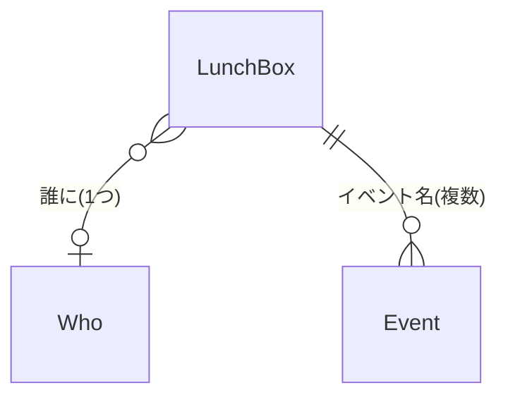

# お弁当日記 設計書

最終更新: 2026-11-13

何を作るかは `spec.md`、決まっていないことは `open-issues.md` に書く。この設計書には、決まった作り方だけを書く。

状態: 試作で確かめた部分を中心にまとめている。機能ごとの状態(検証済み・試作・未着手)は、10章にまとめた。

## 1. 技術構成

| 項目 | 内容 |
|---|---|
| 言語 | Swift |
| UI | SwiftUI |
| 保存 | SwiftData |
| 対象 OS | iOS 17 以上 |

**SwiftData を選んだ理由**
- 永続化が標準で用意されている
- `@Model` により変更が追跡され、SQL を書かなくてよい
- 注意点: `@Model` は class なので、参照が意図せず共有されることがある

## 2. データモデル

フレームは、別テーブルにせず、`LunchBox` の中に持つ(`Frame`)。

**LunchBox(1件の記録)**

| 項目 | 型 | 内容 |
|---|---|---|
| id | UUID | `@Attribute(.unique)` |
| title | String | 料理名 |
| image | Data | 拡大表示用のメイン画像。`@Attribute(.externalStorage)` で外部ストレージに保存する |
| thumbnail | Data | カレンダーのマスやリスト用の小さい画像。小さいので、そのまま持つ |
| date | Date | 選んだ日付を、日本時間の0時(`startOfDay`)にそろえて保存する。読むときも `startOfDay` で、同じ日かどうかを判定する(4章) |
| memo | String? | 任意 |
| events | [Event]? | 複数(決定、2026-11-11)。任意(`nil` または空でもよい)。`LunchBox` が `Event` を複数持つ、1対多で実装済み(決定、2026-11-12)。`Event` 側に、逆向きの参照は持たない |
| who | Who? | 1つだけ。任意 |
| frame | Frame | テーマと色。必須 |

**Event / Who(名前だけを持つ)**

| 項目 | 型 | 内容 |
|---|---|---|
| id | UUID | `@Attribute(.unique)` |
| name | String | |

- 「誰に」とイベント名は、色を持たない(色を持つのはフレームだけ)
- 登録した名前から選ぶ。表記ゆれを防ぐ
- 関連の消し方(記録や、名前を削除したとき)は、まだ決めていない(`open-issues.md`)
- 「誰に」は1つ、イベント名は複数

**Frame(`struct`、`Codable`)**

| 項目 | 型 | 内容 |
|---|---|---|
| theme | FrameTheme | `enum`。`String` の raw 値で保存される |
| color | String | `#RRGGBB`(16進数の文字列) |

**FrameTheme(`enum`)**
- いまの `case`: `def`(ほしの枠)、`stripe`、`autumn`、`polaroid`、`cloud`、`note`、`star`、`mascot`
- 保存されるのは、名前(raw 値)。後から `case` を消したり、名前を変えたりすると、保存済みのデータが読めなくなる
- フレームを別テーブルにしない理由: 記録が覚えるのは、テーマと色だけで足りる。ユーザーがフレームを追加する機能はない。テーブルにすると、規模が増える

## 3. 画面と部品

| 部品 | 役割 |
|---|---|
| ホーム | カレンダーとリストを切り替える |
| 詳細 | シート。複数件のときは横にスワイプして切り替える |
| 作成・編集 | 画面。1つで兼用する。写真の選択・縮小・エラー表示は、部品 `PhotosPickerSection` に分けた(2026-11-16)。`Views/Create/` に置き、作成画面でしか使わない。結果は `@Binding` で、メイン画像とサムネイルを、親に返す |
| `FrameView`(大) | フレーム付きの完成カード(横長)。詳細と、作成・編集のプレビューで共有する共通部品。写真は、窓に合わせて `scaledToFill` で表示する(端が切れる) |
| 写真の全体表示 | カードの写真を `Button` で囲み、押すと写真の全体を見せる(`scaledToFit`)。メイン画像を使う。全画面(`fullScreenCover`)で見せる(決定、2026-11-11)。拡大(ピンチ)できるか、閉じ方は未決 |
| フレーム(小) | カレンダーのマス用の、縦長の小さいカード。`FrameView`(大)とは、別の View として作る(写真の窓の比率が違い、縮小では作れないため) |

**作成・編集の入力途中の扱い**
- `@Model` は class のため、入力欄を記録に直接つなぐと、キャンセルしても元のデータが書き換わる
- そのため、入力途中の内容は一時的な変数(`@State`)に持つ
- 保存ボタンを押したときに、記録へ書き込む
- 親から受け取るだけの値(例: `DayView` の `day`)は、`let` で受け取る。`@State` にすると、親が値を変えても、子は最初の値のまま残るため

## 4. カレンダー

**作り方**
- `UICalendarView` は、マス全体の見た目を変えられないため、採用しない
- 月ごとの表示は、`TabView`(`.page`)で切り替える
- 1か月は、日付を7個ずつに分けて(`chunked(into: 7)`)、`VStack`(週)と `HStack`(日)で並べる
- 1か月は、6行(42マス)に固定する。5行で終わる月は、6行目を空きマスで埋める
  - 確認が必要: 日曜始まりで28日の月(2026年2月)は、4行になり、35マスのままではないか(`open-issues.md`)

**月の持ち方(プロトタイプで検証済み。`verification.md` の2)**
- 前月・今月・来月の3か月分だけを持つ(`[MonthGroup]`)。月を移動するときは、片側に1か月足して反対側を捨てる。今見ている月が、常に真ん中
- 日付は、日本時間の0時ちょうど(`startOfDay`)にそろえる。同じ日かどうかを `==` で比べられる
- 日付の計算には `Calendar.current` を使わず、タイムゾーンを `Asia/Tokyo` に固定した共通の `Calendar`(`Calendar.app`)だけを使う。端末の設定が変わっても、日付が動かないようにするため。画面側も、一番上の View で `calendar` と `timeZone` の環境を同じ値にそろえる(`DatePicker` などが、環境の値を見るため)(決定、2026-11-12)
- 月初の空きマスは、`date` が `nil` の `DateItem` で表す。数は、月初の曜日から決める

**マスの表示**
- 記録がある日: 先頭1件の写真を、フレーム付きの小さいカードで表示する。2件以上は件数のバッジを付ける(バッジは未実装)
- マスに、タイトルは出さない(狭くて崩れたため。`spec.md` 3章)
- 記録がない日: 日付のみ

**カレンダーと記録の連携(検証済み。`verification.md` の6)**
- `@Query` で、記録を全件、日付順に取る
- `Dictionary(grouping:by:)` で、`startOfDay` を鍵にして、日ごとにまとめる(`[Date: [LunchBox]]`)
- `DayView` は、自分の日付で引いて、あれば先頭1件を出す
- 先頭1件は、タイトル順の先頭にする(仕様)。試作は `lunches.first`(日付順の先頭)のまま。`sorted` で直す予定

**日付を押したときの分岐**
- 件数が0: 何もしない
- 件数が1以上: 詳細シートを開く(複数件なら横にスワイプして切り替える)(未実装)

## 5. 写真の保存

- 保存する写真は2種類。どちらも `Data` 型で持つ
  - メイン(拡大表示用): 画面の幅(pt)× 画面のスケールに収まる大きさ。`@Attribute(.externalStorage)` で外部ストレージに保存する
  - サムネイル(マスやリスト用): 200px に収まる大きさ
- どちらも JPEG 品質 0.5 で保存する
- 元画像は保存しない
- `Data` で持つ理由: SwiftData に保存できるのは `Data` で、`UIImage` はそのままでは保存できないため。表示するときに、`UIImage(data:)` で変換する

**保存の流れ**
1. `PhotosPicker` で選んだ写真を `Data` で読む
2. メイン用とサムネイル用の2つを、`shrinkAndComp` で作る(縮小 → JPEG 圧縮 → `Data`)。失敗したらアラートを出す(7章「画像のエラー処理」)
3. 2つを、記録に入れて保存する(元画像は捨てる)
- 記録を削除したときの写真ファイルの扱いは、SwiftData に任せる
- 容量の目安: 1日1件で、1年あたり約83.5MB(実測。`verification.md` の1-2)。元画像を残した場合は約1.2GB/年
- 縦向き写真の向きの確認は、まだ済んでいない

## 6. 検証の記録

試したこと、結果、そこから決めたことは `verification.md` に書く。この設計書には、決まった作り方だけを書く。

## 7. 主な関数

関数の中身(コード)は書かない。名前、受け取るもの、返すもの、役割、流れ、失敗したときの扱いを書く。コード側には、役割を `///` で1行書いておく。

**置き場所**
- `Logic/`: 画面に依存しない関数(例: `shrinkAndComp`)
- `Utils/`: 標準の型への拡張(例: `Calendar+App.swift`、`Date+App.swift`)
- 使い分けの目安(2026-11-15): 材料が `self` とアプリ共通の設定(`Calendar.app` など)だけで決まるものは、extension の計算プロパティにする。複数の型を組み立てるもの(`MonthGroup` を作る、など)や、ほかのデータが材料になるものは、`Logic/` の関数にする

**Date.startOfDay**

`extension Date { var startOfDay: Date }`

- 置き場所: `Utils/Date+App.swift`
- 役割: その日付を、日本時間の0時ちょうどにそろえて返す(`Calendar.app.startOfDay(for: self)`)
- 作った理由(2026-11-15): 保存するときと読むときの両方で使う。`Calendar.current`(端末のタイムゾーン)を、うっかり使うと、日付がずれるため、`Calendar.app` の指定を、1か所に閉じ込めた
- 使っている場所: `CreateView` の保存(`date.startOfDay` を `LunchBox` に渡す)。読む側(日ごとにまとめる処理)は、カレンダーを本体に入れるときに置き換える
- テスト: 書いていない。`Calendar.startOfDay(for:)` を包んだだけで、`Calendar.app` が日本時間であることは、`Calendar+AppTests` が確かめているため

**MonthGroup / DateItem**

| 型 | 項目 | 内容 |
|---|---|---|
| MonthGroup | id: Date | 月初の0時 |
| MonthGroup | dates: [DateItem] | その月のマス。空きマスを含む |
| DateItem | id: UUID | |
| DateItem | date: Date? | 空きマスは `nil` |

**firstDate**

`firstDate(_ date: Date) -> Date`

- 役割: 受け取った日付の、月初の0時を返す
- 失敗したとき: 受け取った日付を、そのまま返す

**getLastDate**

`getLastDate(_ date: Date) -> Date`

- 役割: 受け取った日付と同じ月の、最終日を返す
- 流れ
  1. 翌月の日付を作る
  2. 翌月の「0日」の日付を作る(0日は、前の月の最終日になる)
- 失敗したとき(仮。決め直す): 受け取った日付を、そのまま返す
- 補足: 日付を `print` すると UTC で表示される。日にちは `calendar.component` で取り出す

**daysInMonth**

`daysInMonth(_ date: Date) -> MonthGroup`

- 役割: その月の1日〜最終日と、前後の空きマス(`date` が `nil`)を入れた `MonthGroup` を返す
- 流れ
  1. 月初と最終日を求める
  2. 1日〜最終日の日付を作る
  3. 月初の曜日を調べ、(曜日の番号 − 1)個の空きマスを、先頭に入れる(日曜始まり)
  4. 最終日の曜日から、後ろの空きマスを入れて、週の区切りに合わせる
  5. 35個以下なら、7個足す(6行にするため)
- 失敗したとき(仮。決め直す): 日付が作れない日は、`date` が `nil` になる

**getMonthGroups**

`getMonthGroups(_ date: Date, _ group: [MonthGroup]?) -> [MonthGroup]`

- 役割: 前月・今月・来月の3つの `MonthGroup` を返す。今見ている月が、真ん中になる
- 流れ
  - `group` が `nil`(最初): `date` の前月・今月・来月を作って返す
  - `group` がある: `date` の月が、3つのうち何番目かを調べる
    - 先頭: 先頭に前月を足し、末尾を捨てる
    - 末尾: 末尾に来月を足し、先頭を捨てる
    - 真ん中、またはどれでもない: 何もしない
- 失敗したとき(仮。決め直す): 月が作れなければ、そのまま返す

**getDestMonth**

`getDestMonth(_ date: Date, _ offset: Int) -> Date`

- 役割: 月初に直したうえで、`offset` か月ずらした月初を返す(矢印ボタンの移動先)
- 失敗したとき: 月初を返す(動かない)

**shrinkAndComp**

`shrinkAndComp(_ data: Data, px: CGFloat = 200) throws -> Data`

- 置き場所: `Logic/ImageResize.swift`

- 役割: 写真を縮小し、JPEG(品質 0.5)に圧縮して、`Data` で返す
- 流れ(どの段階でも、失敗したらそこで `ImageResizeError` を投げて終わる)
  1. `px` が 0 より大きいか確かめる(0 以下なら `shrinkSize`)
  2. `Data` から `UIImage` を作る(作れなければ `notImage`)
  3. 画像の長い辺(幅と高さの大きい方)が `px` より大きければ、`preparingThumbnail(of:)` で、`px` 四方に収まる大きさに縮小する(できなければ `cantShrink`)。`px` 以下なら、縮小せず、元の画像のまま次へ進む
  4. `jpegData(compressionQuality: 0.5)` で `Data` にして返す(できなければ `cantCompre`)。圧縮は、縮小したかどうかにかかわらず、必ずかける
- 小さい画像は拡大しない(2026-11-14 に決定): `preparingThumbnail(of:)` は、小さい画像も `px` まで拡大するため、手順3で縮小自体を飛ばす。理由は、拡大しても画質は良くならず、データが増えるだけだから。実際に起きる場面: メインの `px` は画面の幅 × 倍率(約 1179)なので、それより小さい古い写真が入ることがある
- 縦横比は、縮小しても保たれる。短い辺は、整数に丸められる(実測: 1600×900 を `px: 100` にすると 100×56。56.25 が 56 になった)。丸め方は `preparingThumbnail(of:)` に任せていて、公式には決まっていない。テストは、縦横比の差が 0.05 未満であることで確かめる。丸めで 1px ずれても、差は約 0.008(1600×900 の場合)なので、この範囲に収まる
- 返す型を `Data` にした理由: 保存できるのが `Data` だけだから。表示のときに `UIImage` に直す
- 失敗したとき(2026-11-13 に決定): 値を返さず、`ImageResizeError` を投げる。以前の「縮小に失敗すると、元の大きさの画像を圧縮して返す」は、やめた(「元画像は保存しない」と食い違うため)。失敗した写真は、保存の対象にしない

**screenWidthPx**

`screenWidthPx(scale: CGFloat, pt: CGFloat) -> CGFloat`

- 置き場所: `Logic/ImageResize.swift`
- 名前の変更(2026-11-13): `detailPx` から変更。詳細画面専用に読めて、役割(画面の幅をpxにする)とずれていたため。画面の倍率と幅は、View から引数で渡す(`scale`、`pt`)
- 役割: メイン画像の大きさ(px)を返す。画面の幅(pt)× 画面の倍率
- 設計の変更(2026-11-10): `UIScreen.main` をやめた(非推奨のため)。画面の幅は、`.onGeometryChange` で取り、`@State var screenWidthPt` に入れる
- 設計の再変更(2026-11-15): 最初は、一番上の親の View(`ContentView`)で幅を取り、`CreateView` へ引数で渡していた。実機で、`CreateView` が受け取る幅が 0 になり、`shrinkSize` のアラートが出た(親は、ボタンを押す直前に、正しい値を持っていた)。そのため、`CreateView` が、自分で `.onGeometryChange` を使って測る形に変えた。使う場所が `CreateView` だけなので、この形で十分。原因は特定できていない(`open-issues.md`)
- 写真の部品を分けた後(2026-11-16): 幅は `CreateView` が測り、`PhotosPickerSection` へ引数(`screenWidthPt`)で渡す。子の中で測らないのは、`Form` の行の中は画面より狭く、値が小さくなるため。`CreateView` の中の `@State` を子へ渡すだけなので、`ContentView` から渡したときの 0 の問題とは別
- 倍率は、`@Environment(\.displayScale)` から取る(2026-11-11 に置き換え済み)
- 流れ: `displayScale × screenWidthPt`(たとえば 3 × 393 = 1179)
- global な変数には持たない(どこからでも書き換えられる。複数のウィンドウがあると、値が1つに決まらない)
- 動作確認: iOS 17 を対象にして、エラーなしで動いた(確認)
- 幅が 0 のとき(最初のレイアウトの前など): `px` が 0 になるので、`shrinkAndComp` が `shrinkSize` を投げる。`PhotosPickerSection` がアラートを出す(下の「画像のエラー処理」)。写真を選ぶのは、画面が出てからなので、通常は、幅が入っている

**画像のエラー処理**

エラーの型を2つに分ける。

| 型 | 置き場所 | 役割 |
|---|---|---|
| `ImageResizeError` | `Logic/ImageResize.swift` | `shrinkAndComp` が投げる失敗の種類。4ケース: `shrinkSize`(`px` が 0 以下)、`notImage`(画像として読めない)、`cantShrink`(縮小できない)、`cantCompre`(圧縮できない) |
| `ImageError` | `Views/Create/PhotosPickerSection.swift` | アラートに出す失敗の種類。`resize(ImageResizeError)`(変換の失敗)と `loadFailed`(写真の読み込みの失敗)の2つ |

- 分ける理由: `Logic/` は画面に依存しない。利用者向けの文言や、写真の読み込み(`loadTransferable`)の失敗は、画面側の事情なので、`ImageError` に持たせる
- 利用者向けの文言は、`ImageError.message` に持たせる(`switch` で全ケースを書くので、ケースを足し忘れるとビルドで気づける)
  - `notImage`、`loadFailed` → 「写真を読み込めませんでした」
  - `shrinkSize`、`cantShrink`、`cantCompre` → 「うまく処理できませんでした」
- 呼ぶ側の流れ(`PhotosPickerSection` の `.task(id: selectedImage)`。2026-11-16 に、`CreateView` から分けた)
  1. 先に、メインとサムネイルの2つを `nil` に戻す(失敗したとき、前の写真を残さない。食い違いを防ぐ)
  2. 写真を `Data` で読む
  3. メイン用、サムネイル用の順に `shrinkAndComp` を呼ぶ
  4. `ImageResizeError` は `.resize(error)` に包み、それ以外は `.loadFailed` にして、`imageAlert` に入れる(`.task` の中は投げられないので、最後は何でも受ける `catch` で終える)
- アラートは `imageAlert: ImageError?` の1つで管理する。`PhotosPickerSection` が持ち、`nil` でなければ表示し、閉じたら `nil` に戻す(`Binding(get:set:)` で `Bool` に変換)。親の `CreateView` は、写真のエラーを知らない
- 保存は、保存ボタンを押したときだけ行う。変換に失敗しても、保存データには影響しない
- 失敗後に、写真がない状態で保存ボタンを押したときは、入力の検証(下の「入力の検証」)が「写真を選択してください」を出す
- 未決
  - 写真をすばやく選び直したとき、前の処理の中断(`CancellationError`)が、`loadFailed` のアラートになるか(未確認)

**入力の検証(ValidationIssue)**

`ValidationIssue.validate(title: String, mainImage: Data?, thumbImage: Data?) -> [ValidationIssue]`(`static`)

- 置き場所: `Logic/Validation.swift`(型、検証、文言を1ファイルにまとめた。2026-11-17)
- 型: `enum ValidationIssue`。ケースは `titleEmpty`、`noImage` の2つ。値は持たない(「何が足りないか」だけを表す。問題がないときには、値が作られない)
- 役割: 必須の入力に、足りないものがないか調べ、**問題があるものだけを、配列に入れて返す**。問題がなければ空の配列
- 流れ: 1. 空の配列を用意 2. タイトルが空なら `titleEmpty` を足す 3. メイン画像かサムネイルのどちらかが `nil` なら `noImage` を足す 4. 返す
  - `throws` にしない。最初の1つで止めず、全部調べて、まとめて伝えるため
- 引数の `mainImage`、`thumbImage` は `Data?` のまま受ける(「ない」は `nil` で表され、そのまま渡せる)。2つ見るのは、1枚の写真から2つ作るため(どちらかが欠けたら、保存できない)
- タイトルのトリムは、呼ぶ側の仕事。`CreateView` の保存ボタンで、前後の空白と改行を取り、**その結果を、検証と保存の両方に使う**。`validate` は、渡された値が空かどうかだけを見る
- 文言: `ValidationIssue.message`(`String`)。`switch` に `default:` は付けない。`ImageError` の文言を画面側に置いたのとは違い、検証は、すべて `Logic/` の中で完結するので、同じファイルに置いた(多言語にするときは、分ける)
- 呼ぶ側(`CreateView`)
  - `@State issues: [ValidationIssue]` に、保存ボタンを押したときの結果を入れる
  - `issues.isEmpty` なら保存して閉じる。空でなければ、保存しない
  - 保存ボタンは、押せないようにしない(押したあとに、足りない項目の下に、赤い文字で出す)
  - メッセージは、`@ViewBuilder` の関数で、タイトルと写真の下に出す(`issues` に含まれるときだけ)
- 検証しない項目: 日付(`DatePicker` は、必ず日付が入る)、フレーム(初期値があり、`Optional` ではない)。メモ、誰に、イベントは任意
- 任意の入力は、検証ではなく、保存の直前に形をそろえる: メモは、トリムして、空なら `nil`
- 最初の案(2026-11-17): `enum` の各ケースが値を持つ形(`case text(String)`、`case mainImg(Data)`)で、`message` が `String?` を返し、`nil` で「問題なし」を表した。やめた理由: 「写真がない」は `Data?` の `nil` で、`Data` を受けるケースに渡せない。問題がなくても、値が作れてしまう。写真が2つのケースで、同じ文言が2回並ぶ
- テスト: 書いていない。条件が2つだけで、今後も、必須項目が増える予定がない(日付とフレームは、検証しない)。画面でも確かめた
- 動作の確認(2026-11-17): 入力を直しても、次に保存ボタンを押すまで、メッセージは残る。保存ボタンを押すと消える。この動きで、今は、困っていない

**Color(hex:)**

`Color.init?(hex: String)`

- 役割: `#RRGGBB` の文字列から、`Color` を作る
- 流れ: 1. `#` を取り除く 2. 16進数として `Int` にする 3. 赤・緑・青を、ビット演算で取り出し、255 で割る 4. `Color(red:green:blue:)` を作る
- 失敗したとき: 16進数として読めなければ `nil`。呼ぶ側で、`?? .gray` などの代わりの色にする(`FrameView` は `.gray`)
- 未決: 6桁以外の入力(例: `#fff`)の扱い

**colorToStr**

`colorToStr(_ color: Color) -> String`

- 役割: `Color` を `#RRGGBB` の文字列にする(`ColorPicker` の結果を、保存できる形にする)
- 流れ
  1. `color.resolve(in:)` で、赤・緑・青の値を取り出す(iOS 17 以上の API。Xcode で確認)
  2. 0〜255 の整数に、四捨五入で直す
  3. `String(format: "%02X", ...)` で、2桁の16進数にして並べる(桁そろえ)
- 保存の流れ: `ColorPicker` → `Color` → `colorToStr` → `String` で保存。表示は、`Color(hex:)` で戻す

**textColor**

`textColor(_ bg: String) -> Color`

- 役割: 背景色(16進数)の上に置く、文字の色を返す
- 流れ: 1. 赤・緑・青を取り出す 2. 相対輝度を計算する(ガンマ補正し、0.2126・0.7152・0.0722 の重みで足す) 3. 0.35 より大きければ `#3A2E2E`、以下なら `#FFFFFF`
- 失敗したとき: 色が読めなければ、黒
- 補足: 0.35 は、モックを見て決めた値。実機で見て、調整してよい

## 8. フレーム(試作の範囲: 「ほしの枠」の大きいカード)

- テーマごとに、別の View として作る。ユーザーが選べるのは、テーマと色だけ
- 大きさは、全テーマで同じ(大: 326×244、小: 52×68)。写真の窓も同じ(大: 240×144、小: 40×42)

**`FrameView`(大)の作り**

- 入力: 色(16進数の文字列)
- 重ねる順番(下から): 角丸の背景(色は `Color(hex:)`、失敗したら `.gray`)→ 星 → 写真の窓 → 文字
- 背景: 角の丸み 24
- 写真の窓: 240×144、角の丸み 14、上から 16、左右は中央(左から 43)
- 星: `StarPosition`(左、上、大きさ)の配列を `ForEach` で並べる。白。`star.fill`。9個。位置はモックの値
- 文字: 左から 43、上から 170。日付 12pt(不透明度 0.9)、タイトル 19pt、2行の間は 3。色は `textColor`。フォントは「ヒラギノ丸ゴ ProN W4」(指定名は、実機での確認がまだ)
- 未決・直す予定
  - `StarPosition` の `id` が、作るたびに変わる(`UUID()`)。座標が同じなら、同じ `id` になる形にする
  - 星の座標の置き場所(`FrameTheme` の側にする方針)
  - 小さいカードの作り(別の View。星は3つ)

## 9. テスト

- 方針: 関数を作るたびに、「どんな入力に、何が返るべきか」を考える
- 対象にしやすいのは、入力と出力が決まる関数(`Color(hex:)`、`colorToStr`、`textColor`、`getLastDate`、`getMonthGroups` など)
- 考えておく入力の例
  - `Color(hex:)`: `#FFFFFF`、`FFFFFF`(`#` なし)、`#fff`(桁が足りない)、文字が混ざった文字列
  - `colorToStr`: 黒、白、桁が1つ足りない色(赤 10、緑 161、青 15 → `#0AA10F`)。元に戻る(往復)
  - `getLastDate`: 2026年2月(28日)、うるう年の2月、31日の月
- `shrinkAndComp`(`ImageResizeTests.swift`): テスト用の画像は、ファイルを用意せず、`UIGraphicsImageRenderer` で作る(`scale` は 1。大きさが、そのままピクセル数になる)
  - `px` が 0、-1 → `shrinkSize`
  - 画像ではない `Data` → `notImage`
  - 1200×1200 を `px: 100` → 100×100
  - 1200×900、1600×900、600×900 を `px: 100` → 長い辺が 100、縦横比が元と 0.05 未満の差
  - 50×50 を `px: 100` → 50×50 のまま(拡大しない)
  - `cantShrink`、`cantCompre` は、普通の入力では起きないので、テストしない
- `ValidationIssue.validate`: 書かない(理由は、7章「入力の検証」)。「書く・書かない」は、条件の組み合わせの多さ、今後の変更の多さ、書くコストで、関数ごとに決める
- まだ、テストコードを書いていない関数もある

## 10. 機能ごとの状態

この設計書は、試作で確かめた部分から書いている。まだ設計していない機能は、事実のとおり「未着手」と書く。

見た目(レイアウト、余白、色、アニメーション)は、機能がそろってから、全画面をまとめて決める。機能ごとには書かない。

| 機能 | 状態 | 設計書の場所 |
|---|---|---|
| 月のカレンダー(月の切り替え、マスの表示) | 試作で検証済み。件数のバッジ、先頭1件のタイトル順は未 | 4章 |
| 写真の縮小・圧縮・保存 | 検証済み。縦向きの写真の確認は未 | 5章 |
| フレーム | 「ほしの枠」の大きいカードだけ試作。ほかのテーマ、小さいカードは未 | 8章 |
| 作成画面 | タイトル、写真、日付、メモの入力と、必須項目(タイトル、写真)の検証まで実装。誰に、イベント、フレームの選択、プレビューは未 | 3章、7章 |
| 詳細シート | 未着手。方針だけ決定(シート。複数件は横にスワイプ) | 3章 |
| 写真の全体表示 | 未着手。`fullScreenCover` で作ることだけ決定 | 3章 |
| リスト表示 | 未着手。並び順(古い順)・月の見出しは決定済み。表示する範囲は未決 | 11章、`open-issues.md` |
| 検索・フィルター | 未着手。イベント名と「誰に」で絞ることは決定済み。絞り込み中の印の形などは未決 | 11章、`open-issues.md` |
| 「誰に」「イベント」の登録・編集 | 未着手 | `open-issues.md` |
| 削除 | 未着手。確認のアラートを出す方針 | `spec.md` 2章 |

## 11. 未着手の機能の方針(仮)

試作はまだない。方針は、これから確かめるもの。決定した部分と、未決の部分を、分けて書く。

**リスト表示**
- 決定: ホームの中で、カレンダーと切り替える。1日に複数件ある日も、全件を表示する(`spec.md` 2章)
- 方針(仮): `@Query` で、記録を全件取り、並べる。1件ずつ、フレーム付きのカード(大または小)で表示する
- 決定(2026-11-11): 並び順は、初めは古い順(上が古い)。切り替えられる。リストを開いたとき、いま見ていた月の月初の位置まで移動する
- 決定(2026-11-11): 月ごとに見出し(区切り)を付ける
- 方針(仮): 移動先は、月の見出しの `id`(月初の日付)にする。`scrollTo` は、渡した `id` と一致する要素がないと動かないため、記録の有無に左右されない見出しを使う
- 未決: 表示する範囲(`open-issues.md`)

**検索・フィルター**
- 決定: 検索の機能を付ける(家族の要望。イベント名でも絞り込む)
- 方針(仮): 絞り込みの状態(選んだイベント、選んだ「誰に」)を、ホームの `@State` に持つ。`@Query` で取った記録を、先に絞り込んでから、カレンダー(`LunchesByDay`)とリストの両方に渡す。絞り込みのボタンは1つで、押すと選ぶシートが開く。絞り込み中は、画面に分かる印を出す
- 決定(2026-11-11): イベント名と「誰に」で絞り込む。カレンダーでも、リストでも使う(家族の要望)。メモは、対象にしない
- 未決: タイトルでの検索を付けるか(時間があれば)
- 方針(仮): 絞り込みの条件は、イベント名はどれか1つが一致すれば見つかる(複数選んだときも、どれか1つ)、「誰に」と組み合わせたときは、両方に合うものだけを出す
- 決定(2026-11-11): 日付では探さない(月の見出しへの移動で代わりにする)
- 未決: 絞り込み中の印の形。`@Query` の `Predicate` で絞るか、取得後に Swift で絞るか(複数の関連を使う条件が、`Predicate` で書けるかは、未確認)

**詳細シート**
- 決定: シートで表示する。上にフレーム付きのカード、下にイベント名・メモ・操作ボタン。その日に複数件あるときは、横にスワイプして切り替える(`spec.md` 2章)。カードの写真は、押すと全画面(`fullScreenCover`)で全体を見られる
- 方針(仮): その日の記録の配列(`LunchesByDay[日付]`)を、横にスワイプして切り替える部品に渡す(例: `TabView(.page)`)
- 未決: シートの中で、横スワイプが動くか(試作で確認)。「全部で何件か」の伝え方(ページの点、「1 / 3」など)
